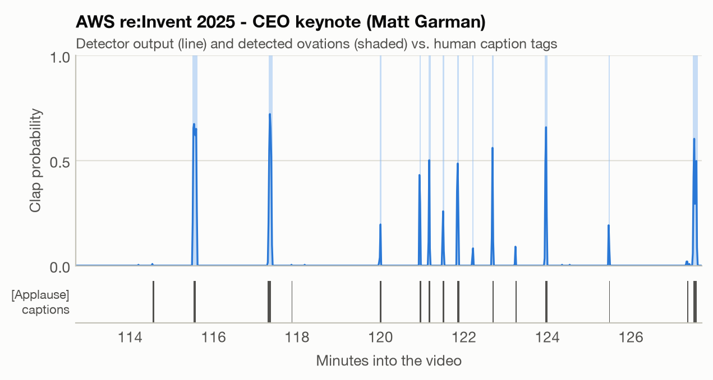
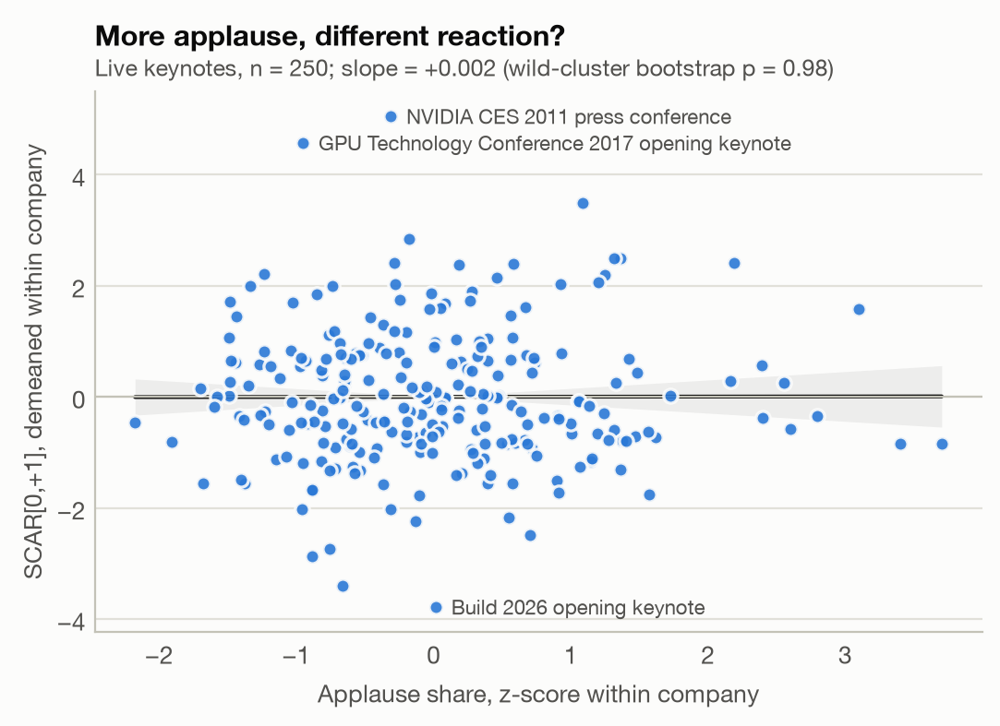
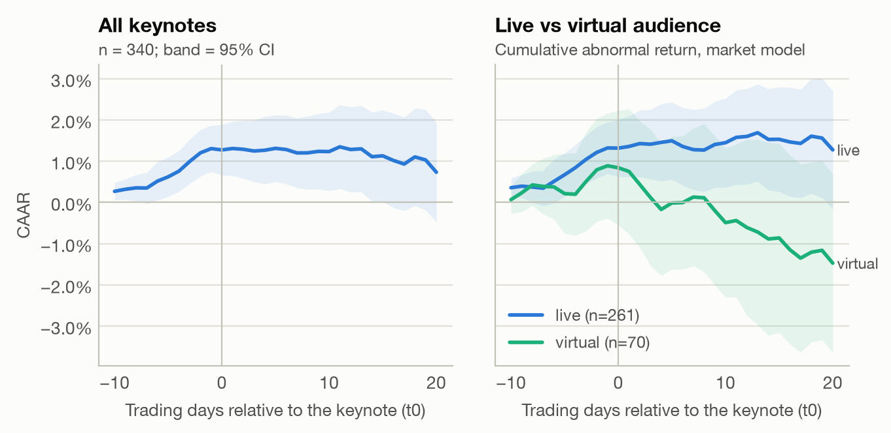

# Does Applause Move Stocks?

**Audience applause at Big Tech keynotes, measured from audio, versus short-run abnormal
returns: an alternative-data event study.**

Every year Apple, Samsung, Google, NVIDIA, Tesla and their peers stage keynotes around a
handful of ovation moments, and clips of the loudest reactions circulate within minutes.
This project asks whether the room knows something the market doesn't. It builds a
hand-curated catalogue of 345 keynotes (2010–2026), turns 327 broadcast recordings into
second-by-second applause timelines with a pretrained audio neural network, validates them
against human caption tags, and tests — with a pre-registered plan — whether louder keynotes
are followed by different stock reactions.

📄 **Full report:** [`reports/unpacked_applause_report.pdf`](reports/unpacked_applause_report.pdf)

## Findings

| | |
|---|---|
| Keynotes catalogued | **345** from 9 companies (Apple, Samsung, Alphabet, Microsoft, Meta, Amazon, NVIDIA, Tesla, AMD) |
| Live-audience keynotes in the main sample | **250** |
| Applause detector vs human `[Applause]` captions (held-out videos) | ROC-AUC **0.91** · precision **0.76** · recall **0.92** |
| **Primary result:** SCAR[0,+1] per 1 SD more applause (within company) | **+0.002** (95% CI −0.15 to +0.15), wild cluster bootstrap *p* = **0.98** |
| Loudest − quietest tercile | −0.05 σ (95% CI −0.43 to +0.34) |
| Placebo (applause moved to random non-event days) | 97% of draws at least as extreme |
| Abnormal return over the 10 sessions *before* keynotes | **+1.3%** (*p* < 0.001) |
| Abnormal return on keynote day and the next [0,+1] | +0.0% (95% CI −0.4% to +0.4%) |

1. **Applause is not a return signal.** Keynotes with more applause than the same company's
   usual are followed neither by higher nor by lower abnormal returns, nor by bigger moves or
   heavier trading. The estimate is precise: effects larger than roughly ±0.3 percentage
   points of two-day return per standard deviation of applause are ruled out.
2. **The reaction happens before the keynote.** Stocks earn +1.3% of abnormal return in the
   two weeks before a keynote and nothing on the day — anticipation, then a muted
   announcement.
3. **Apple and Tesla "sell the news".** Apple's keynotes are followed by −0.7% over two days
   (only 36% positive) and Tesla's by −2.2% (descriptive; nine companies tested).

<p align="center">
  
</p>
<p align="center">
  
  
</p>

## Pipeline

```mermaid
flowchart LR
    A[Hand-curated catalogue<br/>345 keynotes, start time + time zone,<br/>audience type, full video] --> B[yt-dlp<br/>original audio track]
    B --> C[PANNs CNN14 SED<br/>13 AudioSet classes, 1 Hz]
    C --> D[Keynote span + ovation<br/>episodes (hysteresis)]
    E[Human caption tags<br/>&#91;Applause&#93;] --> F[Threshold tuning on dev videos,<br/>evaluation on held-out videos]
    F --> D
    D --> G[Applause measures<br/>within-company z-scores]
    H[Yahoo Finance prices, KOSPI, S&P 500,<br/>Fama-French, earnings dates] --> I[Event study<br/>market model, SCAR, BMP]
    G --> J[DuckDB panel]
    I --> J
    J --> K[Pre-registered analysis<br/>FE regression + wild cluster bootstrap,<br/>BH-FDR, placebo]
    K --> L[Figures, notebooks,<br/>PDF report]
```

**Design choices worth knowing**

* **Event day.** `t0` is the first session whose close is after the keynote starts (exchange
  calendars with early closes and KRX's 2016 close-time change), so a 10 a.m. Pacific Apple
  keynote reacts the same day while an evening Tesla event or a New York Samsung Unpacked
  (after midnight in Seoul) reacts on the next session.
* **Pre-registration.** [`docs/analysis_plan.md`](docs/analysis_plan.md) fixed the
  hypotheses, sample, primary specification and robustness checks in the **first commit**,
  before any applause measure was joined to returns. Two checks added later are labelled
  *exploratory*.
* **Few clusters.** Nine companies are too few for ordinary clustered standard errors, so
  inference uses the wild cluster restricted bootstrap with Webb weights.
* **Measurement validity.** Thresholds are tuned only on human caption tags, never on
  returns; virtual keynotes (no audience) serve as a negative control (median applause share
  0.0% vs 3.9% for live keynotes).
* **Audio hygiene.** YouTube auto-dubbed and "stable volume" (DRC) tracks are excluded; closing
  music performances (Apple booked U2, Sia, Foo Fighters, …) are cut from the keynote span.

## Repository layout

```
data/
  catalog/            events.csv (345 keynotes), per-company research files, curation log
  processed/          applause_features, event_study, ar_paths (parquet + csv)
    timelines/        per-keynote 1 Hz sound-event probabilities (327 files, 21 MB)
  raw/                audio, captions, prices — downloaded on demand, never committed
docs/analysis_plan.md pre-registered plan
notebooks/            01 catalogue · 02 applause detection · 03 event study · 04 applause vs returns
reports/              PDF report, figures, tables, HTML template
sql/                  DuckDB panel construction and coverage queries
src/unpacked_applause/
  catalog.py          catalogue validation and UTC start times
  audio.py            yt-dlp download (original track), ffmpeg decoding, captions
  panns.py            inference-only PANNs Cnn14_DecisionLevelMax (MIT, Kong et al. 2020)
  detect.py           windowed detection on Apple-silicon GPU (MPS) → 1 Hz timelines
  captions.py         caption tag parsing
  validation.py       detector tuning / evaluation against human tags
  features.py         keynote span, ovation episodes, event-level measures
  market.py           prices, Fama-French factors, earnings dates, session closes
  event_study.py      t0, market/FF3/market-adjusted models, CARs, abnormal volume
  stats.py            BMP, generalised sign test, wild cluster bootstrap, permutation, BH
  analysis.py         pre-registered analysis and robustness
  plots.py · report.py · cli.py
tests/                unit tests for the event-study maths, features, statistics, parsing
```

## Reproduce

Requires Python 3.11+, `ffmpeg`, and (for the PDF) Google Chrome.

```bash
python -m venv .venv && .venv/bin/pip install -e ".[dev]"
```

Everything downstream of the audio is reproducible from the committed timelines:

```bash
make market study features analyze figures notebooks report
```

The full pipeline, including downloading ~18 GB of audio (484 hours of keynotes) and
running the detector (about 5 hours on an M3 Pro GPU), is `make all`. The PANNs checkpoint
(`Cnn14_DecisionLevelMax_mAP=0.385.pth`) and the AudioSet label file go into `models/` from
[Zenodo record 3987831](https://zenodo.org/records/3987831) and the AudioSet site.

```bash
make test
```

## Stack

Python · pandas · NumPy · SciPy · statsmodels · scikit-learn · DuckDB (SQL) · PyTorch (MPS) ·
PANNs / AudioSet · librosa · yt-dlp · ffmpeg · yfinance · exchange_calendars · matplotlib ·
Jupyter · Jinja2 + headless Chrome (PDF) · pytest · ruff

## Limitations

Daily returns cannot isolate reactions during the keynote itself; minute-level data around
keynotes held during market hours would sharpen the test. Applause is measured on published
videos whose audio mix varies by production (within-company standardisation and an
official-videos-only check mitigate this). Caption tags are an incomplete ground truth, some
start times are uncertain, and occasionally other news (e.g. a Tesla delivery report) falls
inside the window. The sample is nine of the most liquid stocks in the world.

## Data and licensing

Code is MIT-licensed. Keynote audio is downloaded only to compute derived measures and is
never redistributed; the repository contains only per-second class probabilities, event
metadata and results. Market data come from Yahoo Finance and Kenneth French's data library.
The PANNs model code in `panns.py` is adapted from
[qiuqiangkong/audioset_tagging_cnn](https://github.com/qiuqiangkong/audioset_tagging_cnn)
(MIT).
